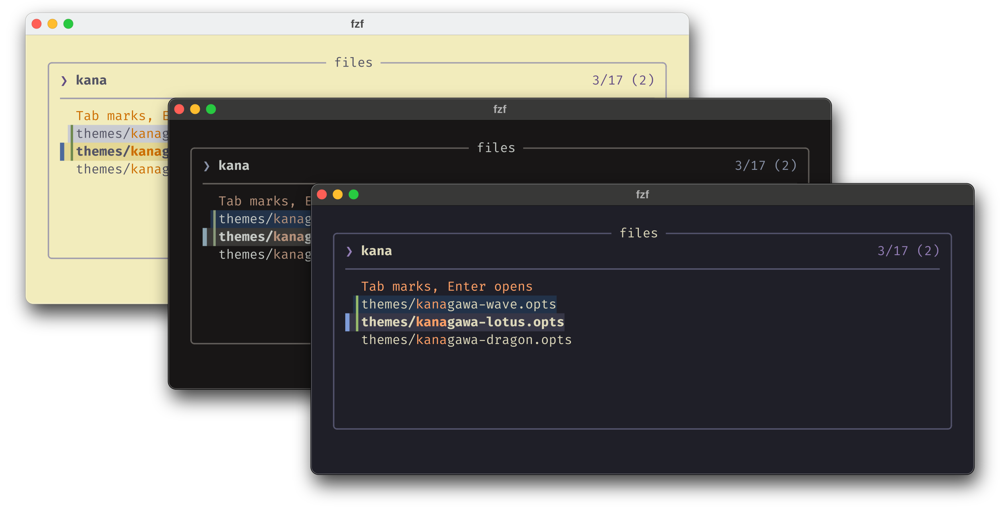
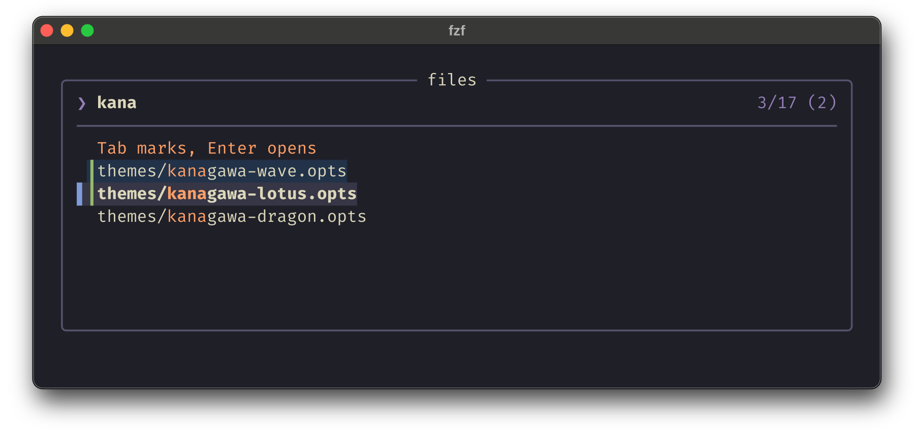
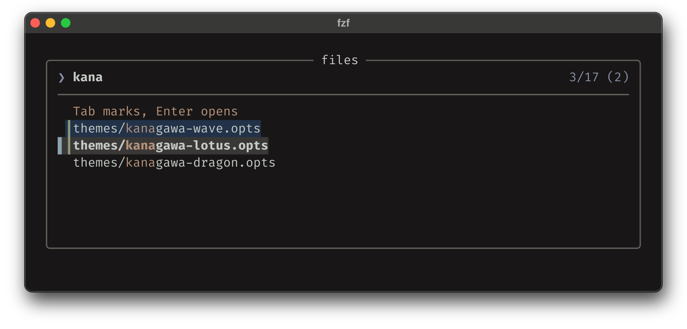
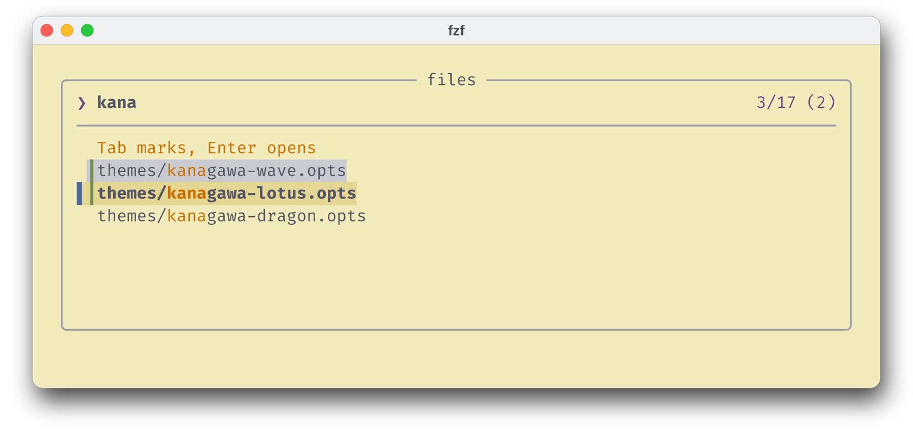

<h3>Kanagawa for <a href="https://github.com/junegunn/fzf">fzf</a></h3>
<p>A community-maintained theme inspired by Hokusai's <em>The Great Wave off Kanagawa</em>.</p>
<p>Using the <a href="https://github.com/rebelot/kanagawa.nvim">Kanagawa palette</a> by <a href="https://github.com/rebelot">Tommaso Laurenzi (rebelot)</a>.</p>

<!-- Wave accents: carpYellow, crystalBlue, autumnRed. Lotus accents: lotusYellow, lotusBlue4, lotusRed. -->
<p>
  <a href="https://github.com/kanagawa-community/fzf/stargazers">
    <picture>
      <source media="(prefers-color-scheme: dark)" srcset="https://img.shields.io/github/stars/kanagawa-community/fzf?style=for-the-badge&amp;labelColor=1F1F28&amp;color=E6C384">
      <source media="(prefers-color-scheme: light)" srcset="https://img.shields.io/github/stars/kanagawa-community/fzf?style=for-the-badge&amp;labelColor=F2ECBC&amp;color=77713F">
      
    </picture>
  </a>
  <a href="https://github.com/kanagawa-community/fzf/releases/latest">
    <picture>
      <source media="(prefers-color-scheme: dark)" srcset="https://img.shields.io/github/v/release/kanagawa-community/fzf?style=for-the-badge&amp;label=release&amp;labelColor=1F1F28&amp;color=7E9CD8">
      <source media="(prefers-color-scheme: light)" srcset="https://img.shields.io/github/v/release/kanagawa-community/fzf?style=for-the-badge&amp;label=release&amp;labelColor=F2ECBC&amp;color=4D699B">
      
    </picture>
  </a>
  <a href="https://github.com/kanagawa-community/fzf/issues">
    <picture>
      <source media="(prefers-color-scheme: dark)" srcset="https://img.shields.io/github/issues/kanagawa-community/fzf?style=for-the-badge&amp;labelColor=1F1F28&amp;color=C34043">
      <source media="(prefers-color-scheme: light)" srcset="https://img.shields.io/github/issues/kanagawa-community/fzf?style=for-the-badge&amp;labelColor=F2ECBC&amp;color=C84053">
      
    </picture>
  </a>
</p>

<br clear="both">
<br>

## Previews



<details>
<summary>🌊 Wave</summary>

</details>

<details>
<summary>🐉 Dragon</summary>

</details>

<details>
<summary>🪷 Lotus</summary>

</details>

## Requirements

- fzf 0.58 or later, which reads options from a file with `FZF_DEFAULT_OPTS_FILE`.

## Installation

Download the three themes into your fzf config folder:

```sh
mkdir -p ~/.config/fzf
for variant in wave dragon lotus; do
  curl -fsSL -o ~/.config/fzf/kanagawa-$variant.opts https://raw.githubusercontent.com/kanagawa-community/fzf/main/themes/kanagawa-$variant.opts
done
```

You can also clone the repository and copy everything in `themes/`.

## Usage

Point `FZF_DEFAULT_OPTS_FILE` at a variant. In bash and zsh:

```sh
export FZF_DEFAULT_OPTS_FILE=~/.config/fzf/kanagawa-wave.opts
```

In fish:

```fish
set -gx FZF_DEFAULT_OPTS_FILE ~/.config/fzf/kanagawa-wave.opts
```

Use `kanagawa-dragon.opts` or `kanagawa-lotus.opts` for the other variants. If you
already use `FZF_DEFAULT_OPTS_FILE`, put the `--color` lines from the theme into
that file instead.

On a transparent terminal, remove the `--color=bg:`, `--color=bg+:` and
`--color=gutter:` lines.

## Palette

Every color comes from the shared
[palette](https://github.com/kanagawa-community/.github/blob/main/docs/PALETTE.md),
picked by role, so each variant uses its own value for the same role.

| fzf color                     | Palette role   |
| ----------------------------- | -------------- |
| `bg`, `gutter`                | `ui.bg`        |
| `bg+`                         | `ui.bg_p2`     |
| `selected-bg`                 | `ui.bg_visual` |
| `fg`, `fg+`, `label`, `query` | `ui.fg`        |
| `hl`, `hl+`, `header`         | `syn.constant` |
| `info`, `prompt`              | `syn.keyword`  |
| `pointer`, `spinner`          | `syn.fun`      |
| `marker`                      | `syn.string`   |
| `border`                      | `ui.nontext`   |
| `disabled`                    | `syn.comment`  |

## Issues and contributions

Report bugs and request changes in this port's
[issue tracker](https://github.com/kanagawa-community/fzf/issues). Contributions are welcome.

See [CONTRIBUTING.md](CONTRIBUTING.md) before opening a pull request.

## License

MIT. See [LICENSE](LICENSE).
